## Planetary systems and their formation history
<figure class="float-right" style="width: 300px;">
  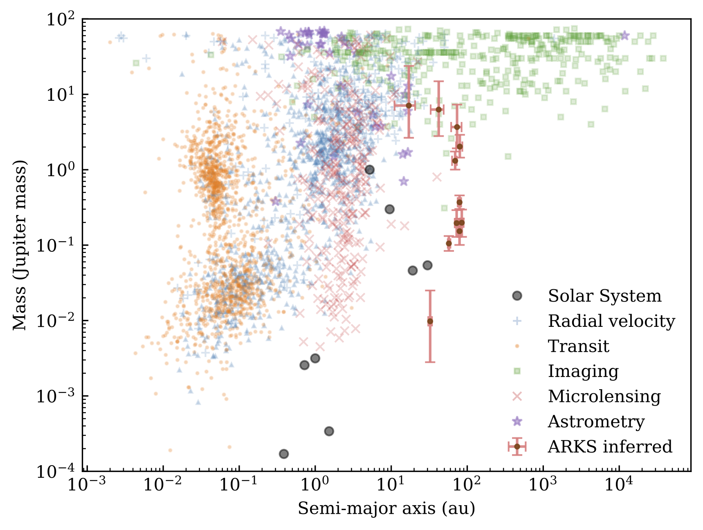
  <figcaption style="text-align: center;">A classic plot showing the mass and radius of planets that have been detected in other Solar Systems</figcaption>
</figure>

One of the most notable discoveries of modern astronomy is that planetary systems are ubiquitously found around stars. Many of them host components that are familiar to us in the Solar System, with each star on average thought to host (at least) a planet, and a fifth of stars (or more) hosting detectable belts of comets. The great diversity among how planetary systems are configured motivates much of the work that follow here, which aims to understand how they form and evolved to their present state, and how they will continue to evolve into the future.  

To zeroth order, we know that gas and dust of interstellar origin (in the giant molecular cloud) collapses into young stars, each eventually surrounded by a protoplanetary disk. Some of this dust grows via sticking, and gravitational collapse assisted by gas, to form planetesimals; some of these planetesimals subsequently grow into terrestrial and giant planets; and the rest of the dust and gas mostly gets accreted by the star or dissipate back into the interstellar medium. 

<figure class="float-left" style="width: 300px;">
  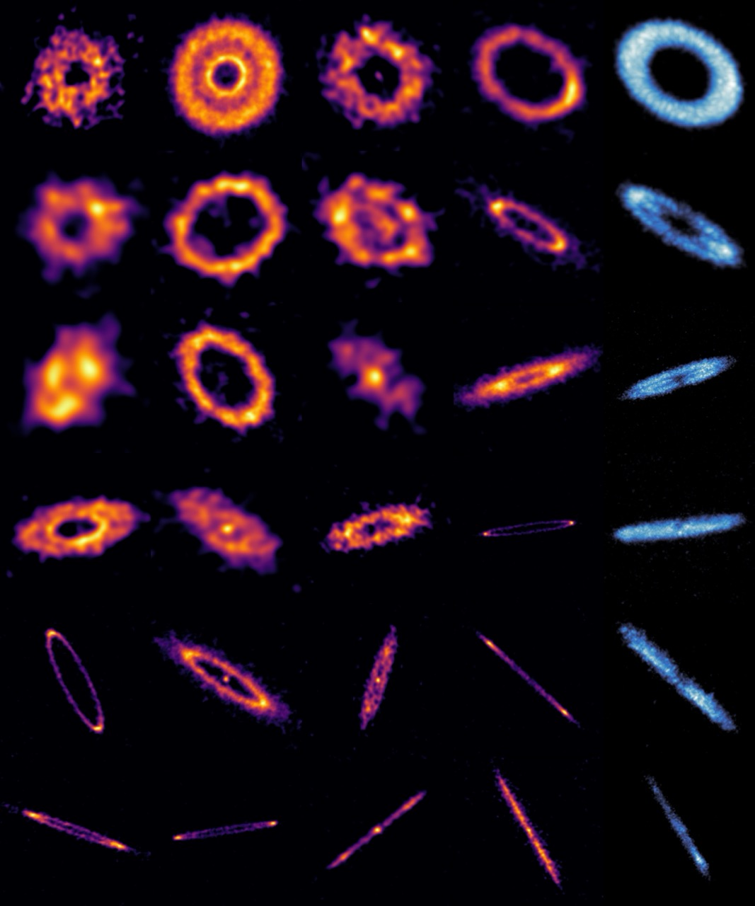
  <figcaption style="text-align: center;">Belts of planetesimals/comets in other Solar Systems from the <a href="https://arkslp.org">ARKS program</a></figcaption>
</figure>
Part of my work focuses on the study of these belts of planetesimals that form but did not become part of planet, analogous to the Solar System's Kuiper Belt from which many of our comets originate. These belts are known as *debris disks*, although to be technical, debris disks often also include analogues of the Solar System's asteroid belt and zodiacal dust found in the inner regions of a planetary system. Debris disks are effectively the only component of extrasolar planetary systems that we can consistently resolve in images, and their structure, e.g., ring width, vertical thickness, number of rings, location of gaps, sharpness of edges, eccentricities and asymmetries...encode dynamical events that the planetary system may have gone through as it formed. There are many questions fundamental to the planet formation story that we are interested in understanding. For example, how much mass ends up as planetesimals in the debris disk, and how does this compare to the solid mass of planets? When (or where) do you form a planet, and when do you form a planetesimal belt? And what does the resolved structure of debris disks tell us about any hidden planets we are unable to detect, and how planet may have migrated in the past? 
  

## Imaging debris disks at high resolution
<figure class="float-right" style="width: 300px;">
  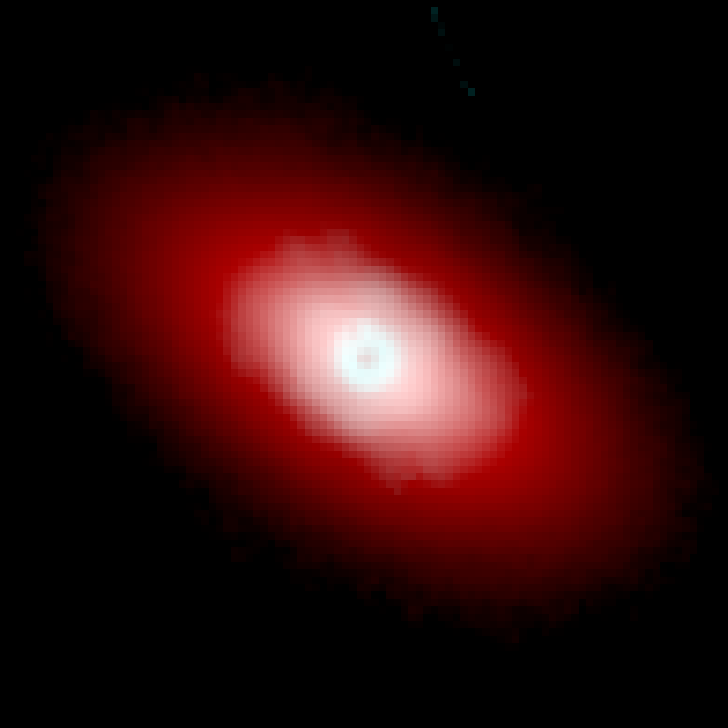
  <figcaption style="text-align: center;">A JWST image of the debris disk of γ Oph combined from 15 and 25 micron filters, <a href="./publications/Han-2026b.pdf">Han <i>et al.</i> 2026b</a></figcaption>
</figure>

The [ALMA observatory](https://www.eso.org/public/teles-instr/alma/) recently imaged two dozen debris disks as part of a survey called [ARKS](https://arkslp.org) (see image in previous section), revealing their high resolution structure across a sizeable sample for the first time. A notable diversity of structures is seen across these observations, from the eerily narrow rings to the multiple concentric rings. Overall individual rings in debris disks seem a lot more similar than we previously thought to rings in young protoplanetary disks of gas and dust from which planets form, but many debris disks are still radially too wide to have directly inherited their structure from protoplanetary disks. [Han *et al.* 2025a](./publications/Han-2025a.pdf) and [Han *et al.* 2026](./publications/Han-2026.pdf) investigated how the distribution of planetesimals could continue to evolve with age following their formation, possibly becoming broader with time based on observations. Whether this reflect primarily the gravitational influence of hidden planets or dynamical evolution intrinsic to the disk is a subject of ongoing investigation.

At shorter wavelengths, observations are sensitive to smaller dust grains that are moved around by stellar radiation from their initial site of production in the belt of planetesimals ([Sommer *et al.* 2025a](./publications/Sommer-2025.pdf)). Even in the absence of radiative forces like radiation pressure and Poynting-Robertson drag, the warmer temperature of inner regions make dust glow even brighter relative to the outer regions when observed by JWST's mid-infrared camera, MIRI. The debris disk image above may look smooth, but it is in fact asymmetric. We can use this asymmetry to infer what kind of planets could be perturbing the disk and direct future observations to search for such a planet. 
  

## Evolution of disk substructures
<figure class="float-left" style="width: 330px;">
  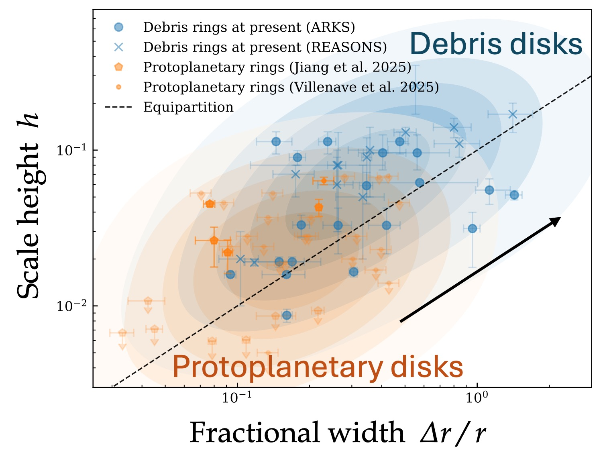
  <figcaption style="text-align: center;">A potential evolutionary trajectory of ringed substructures from protoplanetary to debris disks, <a href="./publications/Han-2026d.pdf">Han <i>et al.</i> 2026d</a></figcaption>
</figure>
Debris disks themselves evolve in time, and playing this evolution back in time can allow us to compare debris disks at their time of formation to the structure of protoplantary disks from which they form, which in turn helps us better understand where and how planetesimals formed. 

One of the main ways that a ring of planetesimals evolve in time is through massive planetesimals mutually deflecting each other. This causes the planetesimal orbits to become increasingly scattered over time, overall in a ring that steadily spreads and becomes radially wider and vertically more puffed up. This spreading, if starting from a thin ring, maintains a characteristic radial width to vertical height ratio, which interestingly most resolved rings in debris disks seem to cluster around. This seems to support the idea that the bulk mass of many of these rings formed in narrow protoplanetary dust rings, where inwardly drifting dust (due to gas drag) are thought to collect at pressure bumps (caused by a variety of possible reasons...) where they rapidly collapse into planetesimals. 

<figure class="float-right" style="width: 330px;">
  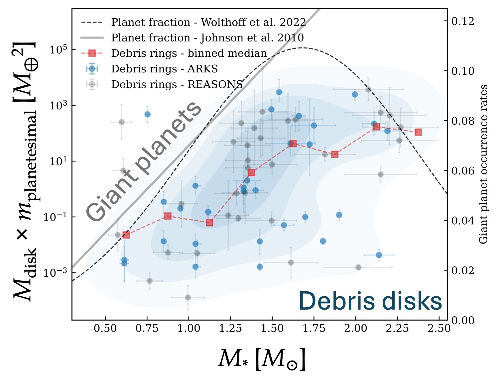
  <figcaption style="text-align: center;">Constraints on the disk mass times individual planetesimal mass in debris disk rings, <a href="./publications/Han-2026d.pdf">Han <i>et al.</i> 2026d</a></figcaption>
</figure>
We can even use the present width of debris rings and their age to estimate how much mass is in the ring, a fundamental quantity that has remained very hard to measure: we can see dust produced through the collisions of planetesimals, but not the planetesimal itself, which holds most of the mass. But unfortunately, here we can only measure a pseudo-mass--the mass of the disk times the mass of an individual planetesimal in the disk. Nonetheless, this is an enlightening quantity to know. In fact, this pseudo-mass seems to be bigger the more massive the host star is, much like what we know about the prevalence of giant planets. So maybe this fits within the simple narrative that more massive stars (up to a certain extent...) host more massive protoplanetary disks, which form more planetesimals quickly enough, which makes it more likely for them to grow big enough to accrete gas and become giant planets. 
This is maybe a satisfactory story to first order, but it is likely not the full picture. I would encourage more work in this area. 
  

## Dynamics of debris disks and planets
The structure of debris disks tells us about any potentially hidden planets which may be perturbing the disk. An often invoked example is the way gaps in debris disks could be carved by planets, which could range from a few Neptunes to a few Jupiters in mass at a few tens of astronomical units based on the kind of radial gaps that we observe. A population of these planets were inferred based on debris disks in the ARKS program, which are shown on the first plot on this page. 

<figure class="float-left" style="width: 300px;">
  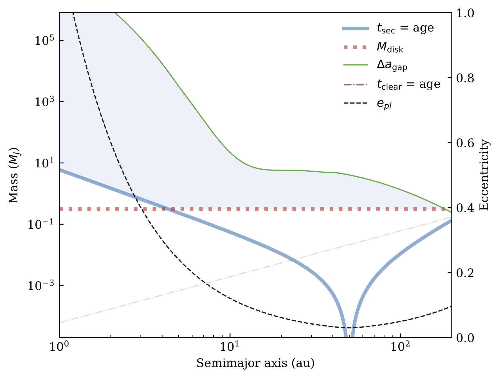
  <figcaption style="text-align: center;">Constraints on perturbing planets capable of causing γ Oph's asymmetry, <a href="./publications/Han-2026b.pdf">Han <i>et al.</i> 2026b</a></figcaption>
</figure>

Detailed studies of individual disks can often provide insight into its dynamical history. An example is the edge-on debris disk of $$\beta$$ Pic, with the abundance of observations and substructures discovered placing it as an archetypal system. Notably, a vertical warp found in the disk visible from [Hubble Space Telescope](https://hubblesite.org/contents/media/images/2015/06/3490-Image.html) images was used to predict a subsequently confirmed interior planet secularly perturbing the disk. Interestingly, the vertical height of $$\beta$$ Pic varies between smaller dust grains at mid-infrared wavelengths compared to the larger dust grains at millimetre wavelengths, which could be due to radiation pressure that dynamically excites the smaller grains more effectively ([Han *et al.* 2025c](./publications/Han-2025c.pdf)). 

<figure class="float-left" style="width: 300px;">
  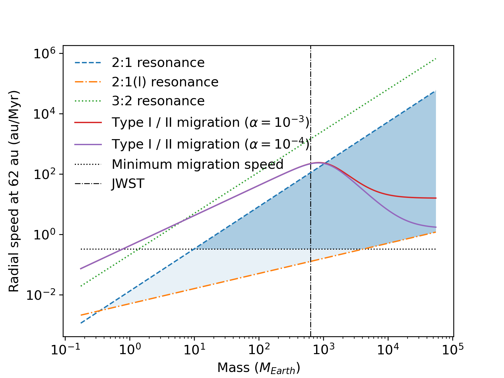
  <figcaption style="text-align: center;">Planet migration scenarios under a mean-motion resonance model for the dust clump in β Pic</figcaption>
</figure>

$$\beta$$ Pic also hosts a large clump of dust and gas on one side of the disk but not the other. If such a clump reflects distributions of planetesimals trapped by mean motion resonance with an unseen planet, we can infer the mass and migration scenario of the planet required to match observational constraints on the dust clump's motion, which we tracked with images that span 12 years in [Han *et al.* 2023](./publications/Han-2023.pdf). More recent images from the [James Webb Space Telescope](https://webbtelescope.org/contents/media/images/2024/101/01HKAHK9XJKKR4MFFSST52K2BY) has uncovered an additional suite of structures that could be due to collisions ([Rebollido *et al.* 2024](https://ui.adsabs.harvard.edu/abs/2024AJ....167...69R/abstract)). Coherently explaining these features is a topic of ongoing work. 
  

## From image to 3D structure

<figure class="float-right" style="width: 300px;">
  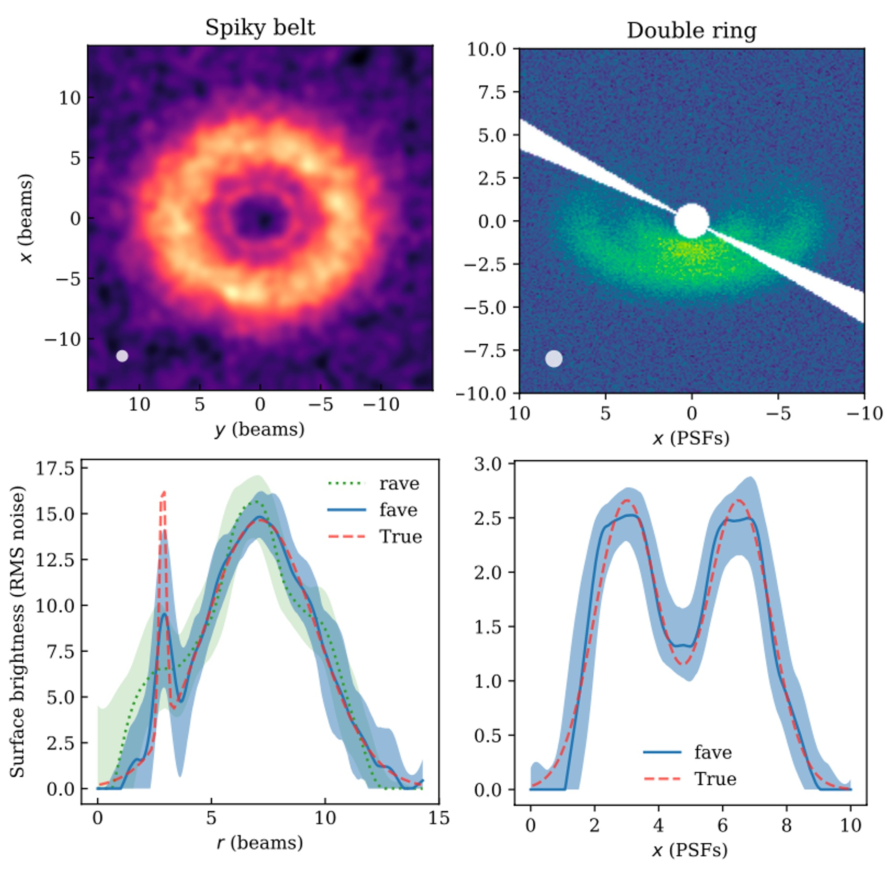
  <figcaption style="text-align: center;">Nonparametrically fitting the disk structure in simulated thermal emission and scattered light images</figcaption>
</figure>

We may be able to image debris disks, or indeed any type of astrophysical disk, but accurately knowing its 3D structure from the image requires some careful modelling. In addition to projection effects for a disk that is viewed at an angle, the disk has a vertical height, the "true image" is convolved with a point spread function due to diffraction and the image is noisy, making naïve deconvolution difficult to proceed robustly. Rather than assuming a functional form for the radial profile of the disk and fitting to its best-fit parameters, [Han *et al.* 2022](./publications/Han-2022a.pdf) developed an algorithm that directly takes in a disk image and figures out its deconvolved and deprojected radial profile, as well as the vertical height as a function of radius if the disk is sufficiently edge-on. This method fits concentric annuli regularised by randomising annuli boundaries, assuming the disk is optically thin, as satisfied for debris disk dust, and that the disk is azimuthally symmetric, which is generally applicable given the typical degree of symmetry of debris disks. The algorithm, [rave](https://yinuohan.github.io/rave/), has been further extended to optimise for face-on disks (dubbed "fave"...[Han *et al.* 2025](./publications/Han-2025a.pdf)).

The nonparametric method, frank, has also been developed ([Jennings *et al.*, 2020](https://ui.adsabs.harvard.edu/abs/2020MNRAS.495.3209J/abstract)) to fit specifically to visibility data obtained with interferometry, which has been extended to model the radial profile and vertical height of debris disks based on ALMA observations ([Terrill *et al.* 2023](./publications/Terrill-2023.pdf)). Equipped with these and parametric modelling tools, now is the time to observe more disks and uncover their structure!
  

## Dusty Wolf-Rayet stars

<figure class="float-right" style="width: 200px;">
  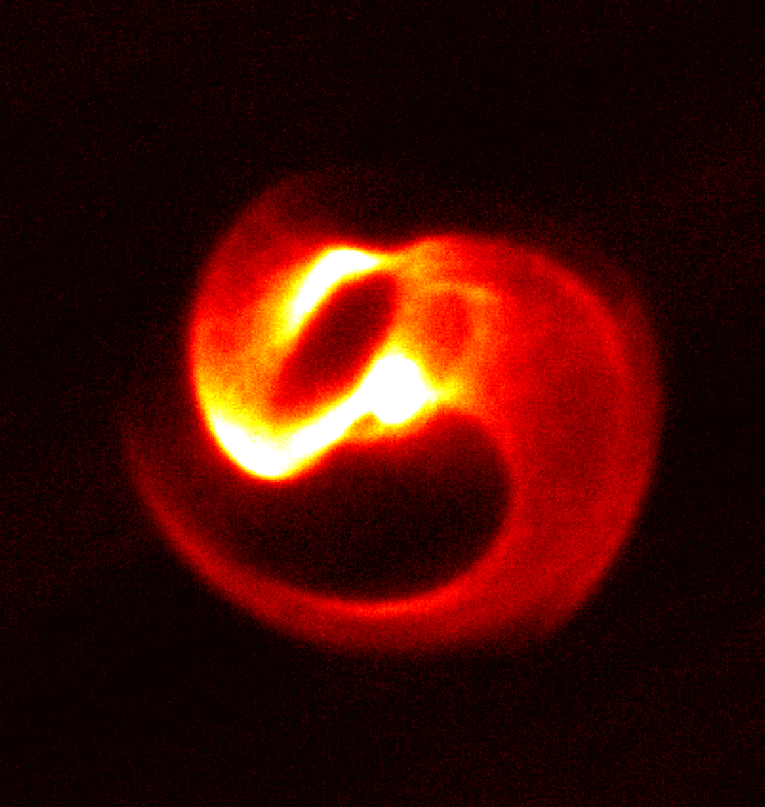
  <figcaption style="text-align: center;">Apep as seen by the VLT, <a href="./publications/Han-2020.pdf">Han <i>et al.</i> 2020</a> </figcaption>
</figure>

Dust and gas in the interstellar medium collapse to form dense, rotating disks, at the centre of which, upon accretion of sufficient amounts of gas, a young star emerges and illuminates its surrounding. In the protoplanetary disk that surrounds it, microscopic particles of dust coagulate, growing under some different combinations of sticking, gravity and giant impacts at various stages to eventually form planetesimals and terrestrial to giant planets. Upon dispersal of the gas disk, belts of planetesimals formed from dust continue to collide, only this time violently enough to release more dust than they the amount by which they grow, with the dust grinding down until small enough to be blown out of the system via radiation pressure, returning the material from which the planetary system formed back to the interstellar medium, while allowing us to image their distribution and infer the very presence of a planetary system. 

<figure class="float-right" style="width: 200px;">
  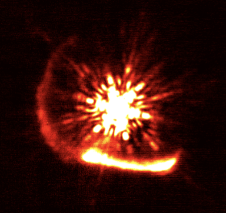
  <figcaption style="text-align: center;">WR140 as seen by Keck, <a href="./publications/Han-2022b.pdf">Han <i>et al.</i> 2022b</a> </figcaption>
</figure>

Where does this planet-forming dust come from? Evolved stars are known to be important dust producers, however the most massive of them could have an outsized role to play. Stars greater than about two dozen times the mass of the Sun evolve so quickly that by the time most stars would have just started forming planets, they are well on their way to becoming supernovae. During their final phase of evolution, they are known as Wolf-Rayet stars, characterised by extremely high luminosities ($$10^6$$ solar luminosities), fast stellar winds (3,000 km/s) and high mass loss rates ($$10^{-5}$$ solar masses per year) and sometimes, perhaps surprisingly, they are extremely prolific producers of carbonaceous dust. 

<figure class="float-right" style="width: 200px;">
  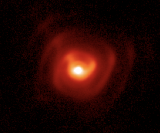
  <figcaption style="text-align: center;">WR112 as seen by the VLT, <a href="./publications/Lau-2020.pdf">Lau <i>et al.</i> 2020</a> </figcaption>
</figure>

Imaging efforts have been able to reveal the detailed dust structure emerging from a handful of these systems. Examples of several systems that I have been studying are displayed on this page. Although Wolf-Rayet binaries are typically thousands of kiloparsecs away, their extremely fast wind and dust expansion allow us to see their motion on the timescale of a year, and dust expansion has been observed in all three examples displayed in this section. SED modelling has also revealed a population of very small dust grains in WR140 that appear to be nanometres in size, potentially contributing to the carbonaceous nanodust population in the interstellar medium ([Lau *et al.* 2020](./publications/Lau-2023.pdf)). 

Remarkably, JWST has been able to reveal not one but 20 concentric dust shells in WR140 that span light years in size, vividly demonstrating how dust produced within the system marches deep into the interstellar medium. Follow-up JWST observations have been able to observe expansion of the these outer dust shells ([Lieb *et al.* 2025](./publications/Lieb-2025.pdf)), and spectroscopic observations are allowing us to map the 3D velocity field and chemical composition of dust produced by WR stars. JWST is proving to be a useful tool in our understanding of the nature of dusty WR stars. 
  

## The geometry of colliding-wind binaries

The dust structures produced by Wolf-Rayet stars can be spectacular, but how are they formed? Behind this diverse range of geometries is in fact an elegant common mechanism that links them together. The few examples of Wolf-Rayet dust shown above are in fact produced by binary stars, consisting of one WC-type Wolf-Rayet star and another massive companion star which is usually an O, B or even another WR ([Callingham *et al.* 2020](./publications/Callingham-2020.pdf)) star. Their powerful stellar winds violently collide with each other, and we could even image the geometry of the shock region at radio wavelengths ([Marcote *et al.* 2020](./publications/Marcote-2020.pdf)). It is along their shock interface that high densities and the right cooling conditions are reached and carbon dust is thought to form. 

The shock front is, however, not quite a flat interface. The WC star with the stronger wind momentum bends the shock interface towards the direction of its companion star, creating a shock "cone" geometry where the newly forming/formed dust coasts away from the binary along the surface of the imaginary cone. As the binary stars orbit each other, the shock cone at each moment in time is offset in angle from the previous along the binary's orbit, creating a 3D spiral of dust which we can image in the infrared. In essence, this is much like a typical garden sprinkler. Each drop of water is moving radially away, but the spinning sprinkler wraps their combined configuration at any moment in time into a spiral. 

But the images from the previous section looking nothing like simple spirals. Part of this is due to the 3D nature of the geometry, which creates limb-brightened edges that exhibit larger optical depths along the line of sight than the rest of the dust surfaces. But the orbit can also modulate the rate at which dust is produced, turning off some parts of the dust spiral where binaries on eccentric orbits may be too far apart for their winds to collide at sufficiently high densities, resulting in disconnected arcs. [Han *et al.* 2022b](./publications/Han-2022b.pdf) found that this modulation can happen in a variety of ways, and dust production also appears to shut down when the binary is too close. Furthermore, the distribution of dust along the shock cone appears to be asymmetric, with the trailing edge being more dense than the leading edge along the orbit. 

The images of the beautiful dust structures allow us to construct models that connect the orbit of the binary at the center of the dust-producing engine with the geometry of the dust and its inflation. In effect, the dust serves as a record for the physical conditions from which they are produced along the orbit. This page displays some of the animations of models for the observations displayed in the previous section. 

<figure class="gif_grid">
  
  <figcaption style="text-align: center;">If Apep produced dust continuously</figcaption>
</figure>

<figure class="gif_grid">
  
  <figcaption style="text-align: center;">Zooming into Apep</figcaption>
</figure>

<figure class="gif_grid">
  
  <figcaption style="text-align: center;">Zooming out of Apep</figcaption>
</figure>

<figure class="gif_grid">
  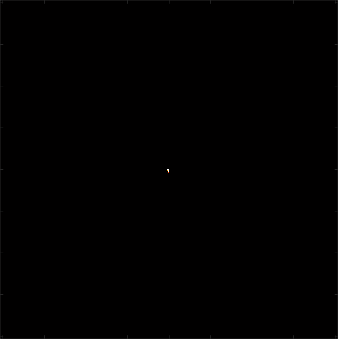
  <figcaption style="text-align: center;">Constructing a model for Apep</figcaption>
</figure>

<figure class="gif_grid">
  
  <figcaption style="text-align: center;">Removing dust near apastron</figcaption>
</figure>

<figure class="gif_grid">
  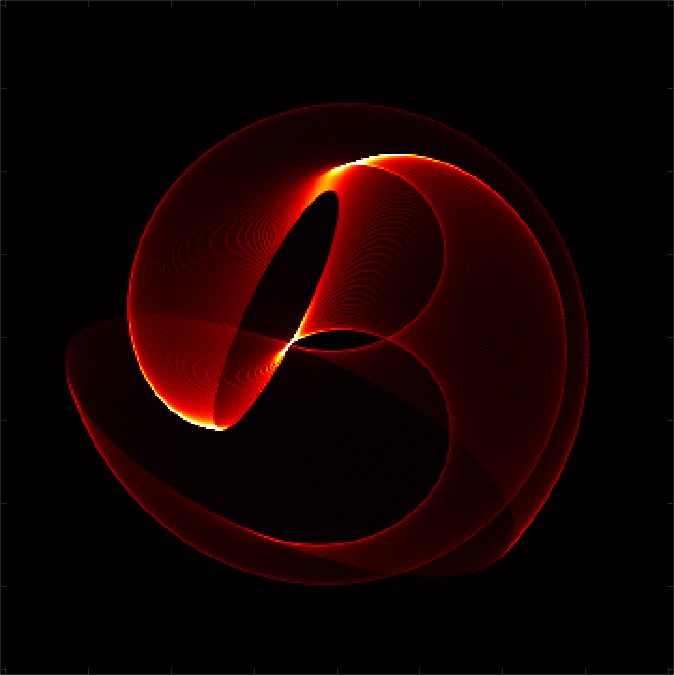
  <figcaption style="text-align: center;">Wobbling Apep around</figcaption>
</figure>

<figure class="gif_grid">
  
  <figcaption style="text-align: center;">Transforming Apep's geometry</figcaption>
</figure>

<figure class="gif_grid">
  
  <figcaption style="text-align: center;">Actual Apep's evolution in time</figcaption>
</figure>

<figure class="gif_grid">
  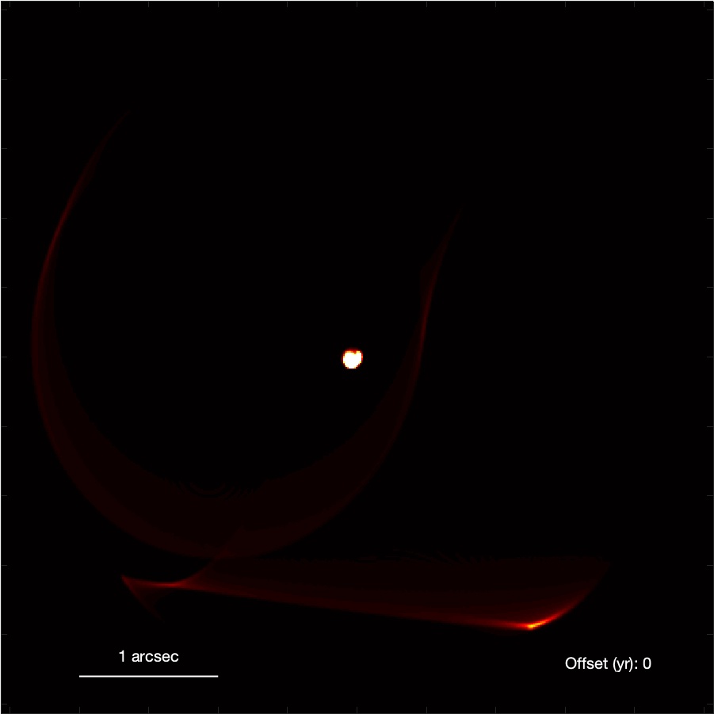
  <figcaption style="text-align: center;">WR140 evolving in time</figcaption>
</figure>

<figure class="gif_grid">
  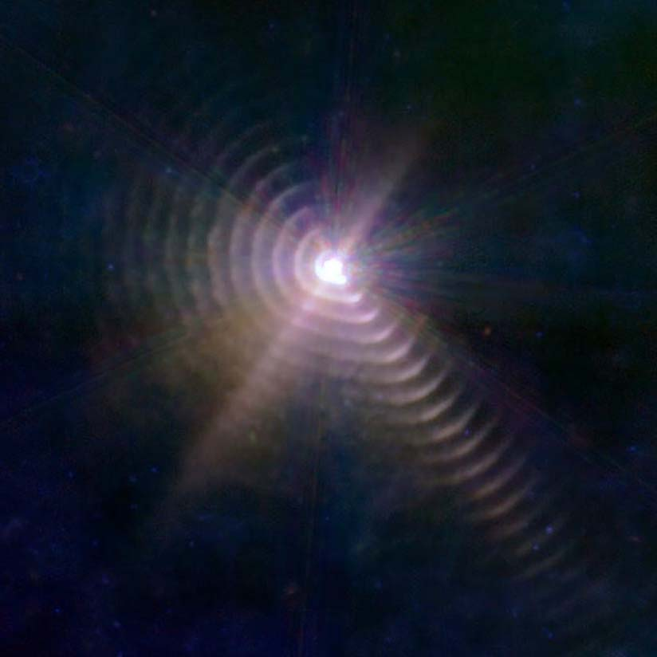
  <figcaption style="text-align: center;">WR140 as seen by JWST, <a href="./publications/Lau-2022.pdf">Lau <i>et al.</i> 2022</a> </figcaption>
</figure>

<figure class="gif_grid">
  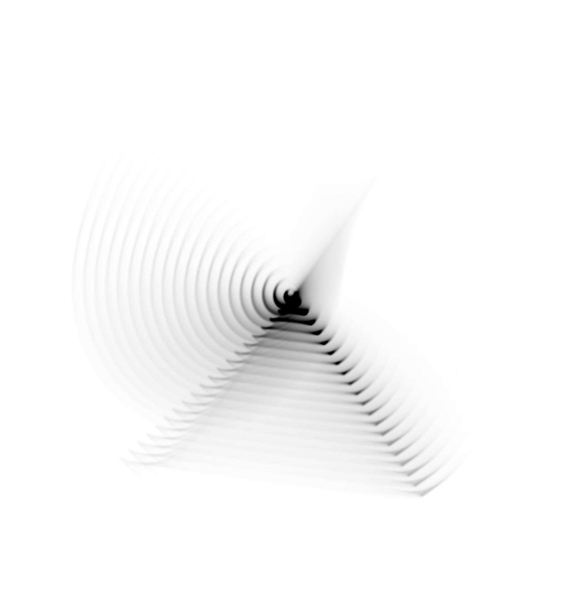
  <figcaption style="text-align: center;">WR140 model</figcaption>
</figure>

<figure class="gif_grid">
  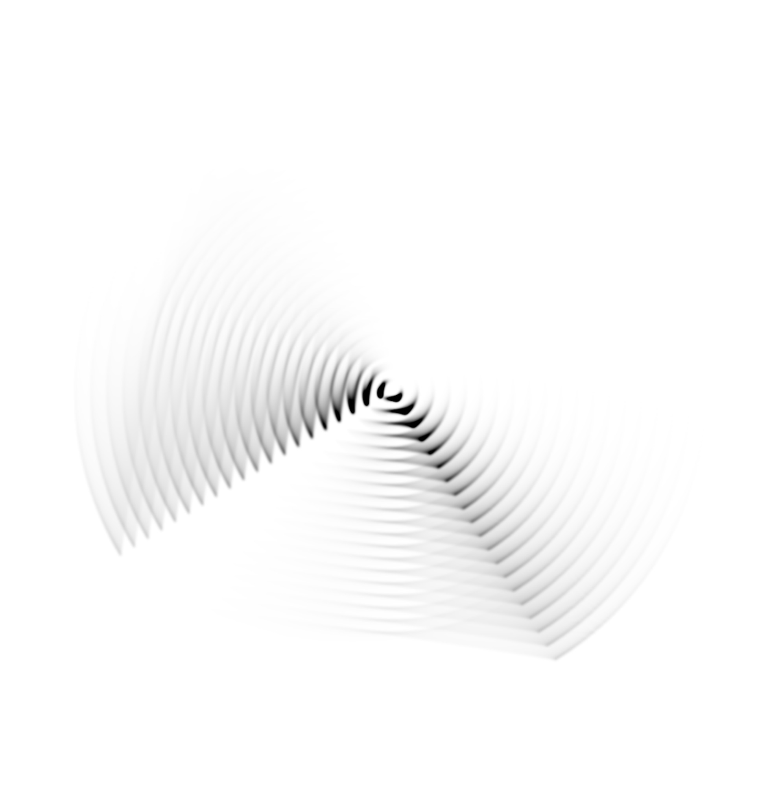
  <figcaption style="text-align: center;">WR140 model face-on view</figcaption>
</figure>

<figure class="gif_grid">
  
  <figcaption style="text-align: center;">Constructing a model for WR112</figcaption>
</figure>

<figure class="gif_grid">
  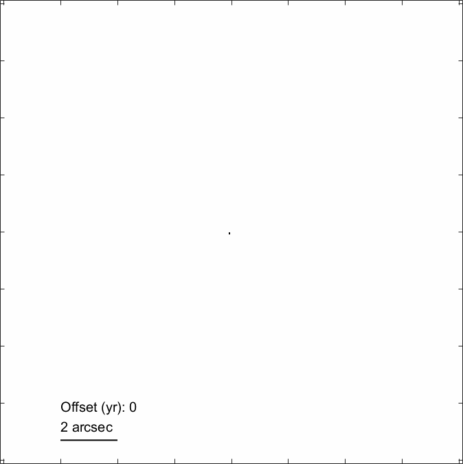
  <figcaption style="text-align: center;">Constructing a model for WR112 viewed face-on</figcaption>
</figure>

<figure class="gif_grid">
  
  <figcaption style="text-align: center;">Rotating WR112 around</figcaption>
</figure>

<figure class="gif_grid">
  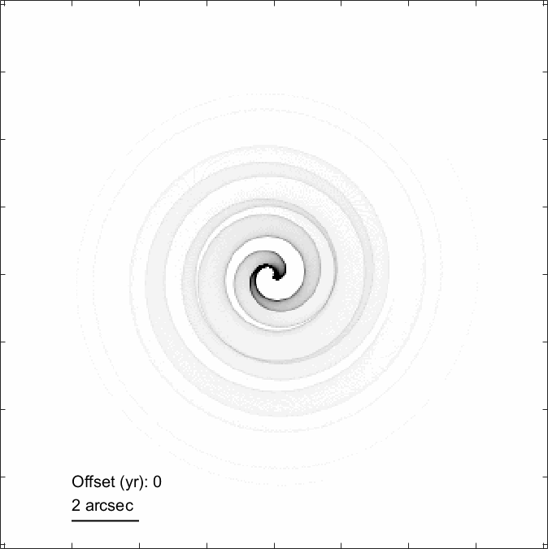
  <figcaption style="text-align: center;">Rotating WR112 around while pausing the clock</figcaption>
</figure>

<figure class="gif_grid">
  
  <figcaption style="text-align: center;">Actual WR112 evolving in time</figcaption>
</figure>

<figure class="gif_grid" style="margin-bottom: 50px;">
  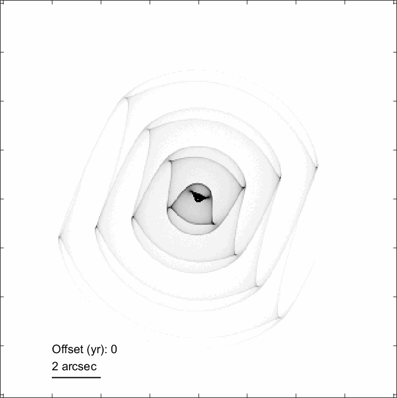
  <figcaption style="text-align: center;">Actual WR112 evolving in time, more slowly...</figcaption>
</figure>

## Light and dust

<figure class="float-right" style="width: 300px;">
  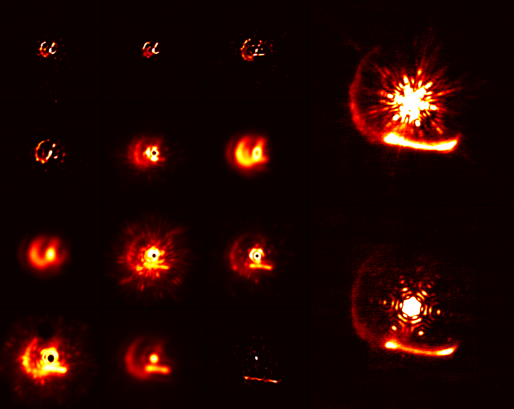
  <figcaption style="text-align: center;">The expanding dust shell of WR140</figcaption>
</figure>

Stellar radiation exerts a range of dynamical effects on matter in its vicinity. These are most prominently felt by small bodies, which generally have a large cross-sectional area per unit mass. In planetary systems, dust grains experience Poynting-Robertson drag, causing them to spiral towards to the star from the belts of planetesimals where they are created. In the Solar System, this results in the [zodiacal dust](https://www.jpl.nasa.gov/images/pia24432-zodiacal-light/). The same occurs in extrasolar systems, where dust has been observed to permeate the region interior to planetesimal belts, the distribution of which in the Fomalhaut system could be explained by Poynting-Robertson drag ([Sommer *et al.* 2025](./publications/Sommer-2025.pdf)).

For even smaller dust grains, radiation pressure becomes strong enough to eject them from the planetary system altogether. As they leave the system and head towards the void, the trail of small grains create a halo of emission seen at optical or near-infrared wavelengths. 

In dust-producing Wolf-Rayet binaries, the well-defined geometry of dust structures and their spatially confined edges create an ideal opportunity to track the motion of dust. Radiation pressure is also particularly strong around these extremely luminous stars, and [Han *et al.* 2022b](./publications/Han-2022b.pdf) were able to measure an acceleration of the circumstellar dust shell that could be explained by plausible radiation pressure strengths in these systems, placing observational constraints on the radiation pressure efficiency and the dust to gas ratio around Wolf-Rayet stars.
  

## Imaging at high angular resolution

<figure class="float-left" style="width: 230px;">
  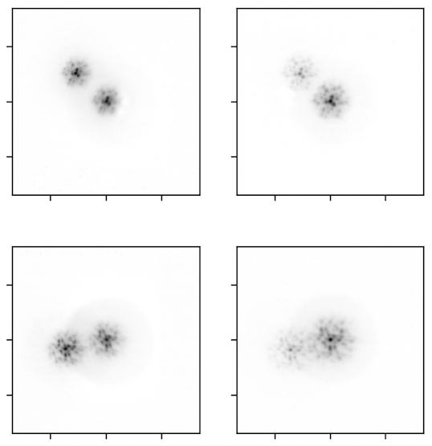
  <figcaption style="text-align: center;">Near-infrared aperture masking interferograms of Apep</figcaption>
</figure>

Imaging structures in distant planetary systems and stars often requires very high angular resolution. Observatories like ALMA achieve this at millimetre wavelengths through interferometry, setting up large arrays with long baselines. In optical and near-infrared wavelengths, the limiting factor is often the Earth's atmosphere, which could be partly mitigated with better calibration enabled by techniques like aperture masking interferometry for bright targets, as pioneered by [Tuthill *et al.* 2000](https://ui.adsabs.harvard.edu/abs/2000SPIE.4006..491T/abstract). The example interferograms shown in this section are those of Apep. Of the two stellar components, only one is a Wolf-Rayet binary, based on which [Han *et al.* 2020](./publications/Han-2020.pdf) were able to measure the 50 milliarcsecond separation and position angle of the binary. 

Even in the absence of atmospheric interference, optical interferometry with an aperture mask could effectively double the spatial resolution of a telescope. The James Webb Space Telescope carries such a mask, which has been used to observe and reconstruct images of dust around WR137 that is robust against the method of image reconstruction used [Lau *et al.* 2024](./publications/Lau-2024.pdf). These high-resolution imaging techniques are central to many of the discoveries on which the science themes on this page are based. 